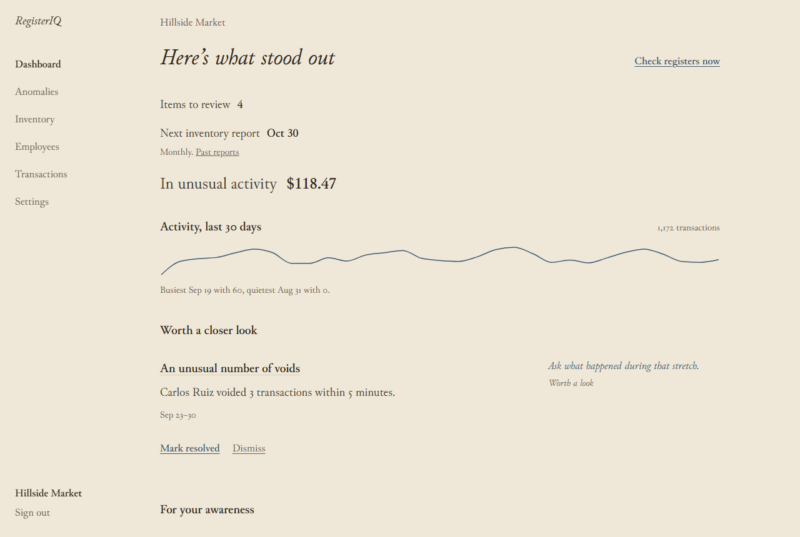
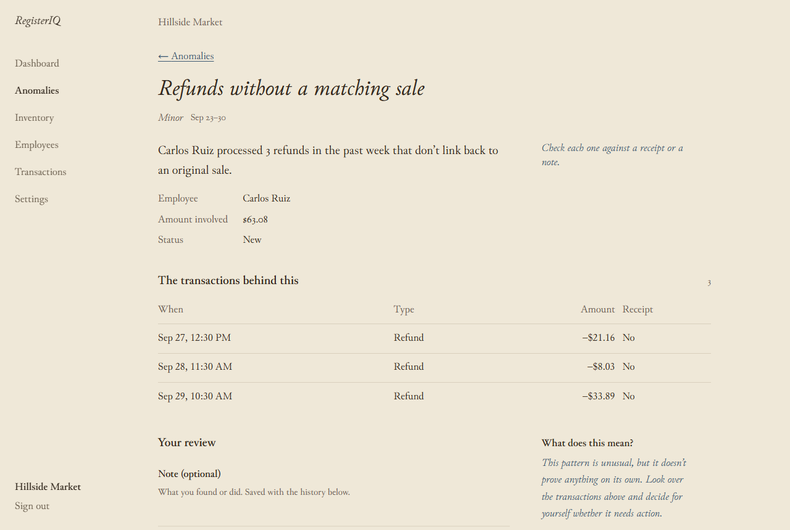
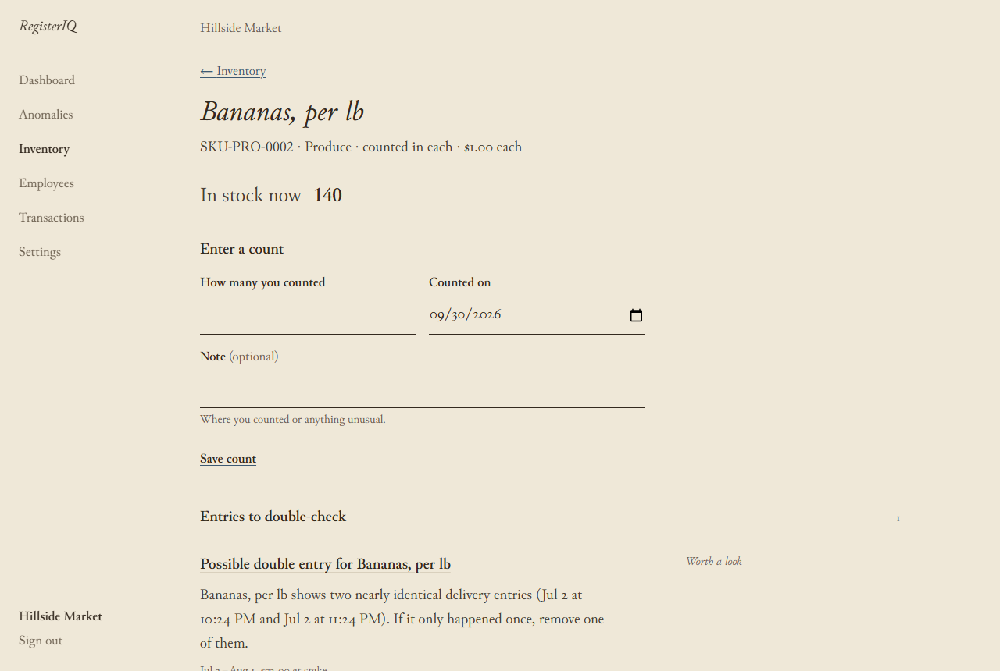
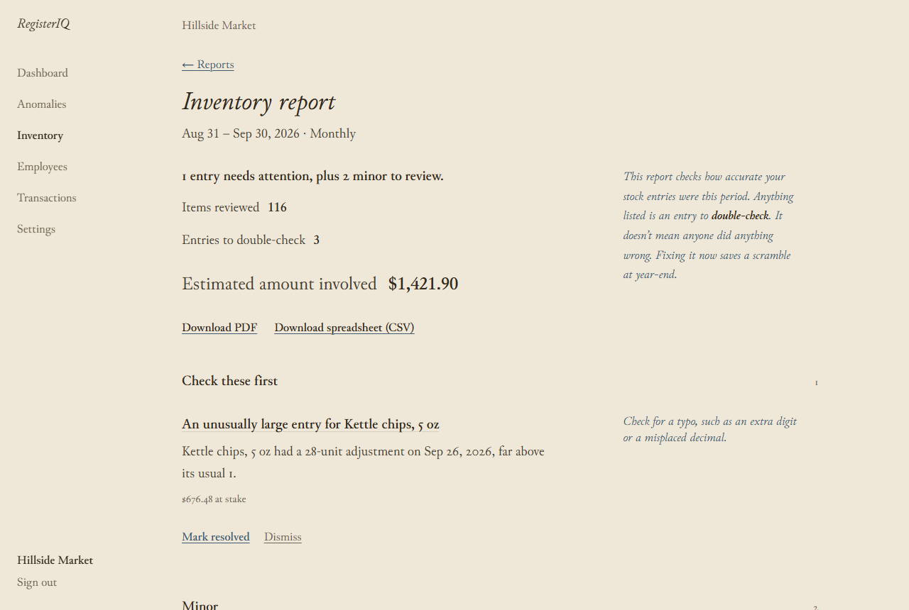
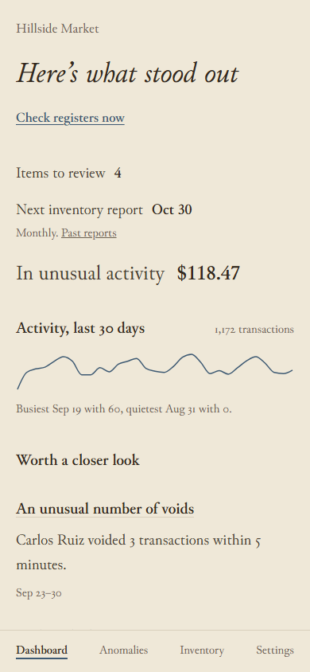

# RegisterIQ

RegisterIQ reads a shop’s till and stock records and points out what doesn’t add up.
It runs on the shop’s own computer, and nobody else sees the data.

This repository is a showcase of the app. The app’s code is kept private.

## See it

- **The demo page:** a short tour with the video and screenshots, published from this
  repository with GitHub Pages.
- **The demo store:** every main page of the app, saved with sample data so you can
  click through it. Open `app/dashboard.html` from the demo page. It’s a snapshot:
  buttons and forms are switched off.
- **The video:** [`video/registeriq-demo.webm`](video/registeriq-demo.webm), about 35
  seconds with captions and no sound.

## What it checks

At the register: refunds that don’t match an earlier sale, several voids close
together, a cash drawer that keeps coming up short, and voids or refunds after closing
time.

In stock entries: stock that goes below zero, a delivery typed in wrong, the same
delivery entered twice, and counts that don’t match what came in and went out.

Each finding shows the records behind it and a next step. The owner decides what it
means and notes what they did.

## Where it’s at

RegisterIQ is in its pilot. It runs on realistic sample data and on sales and stock
files a shop exports from its till. Connecting to a till directly comes next, starting
with Square. It’s made for independent shops with one to five locations.

## Screenshots

| | |
|---|---|
|  |  |
|  |  |

## Contact

Email yourname@example.com.

## Rights

© 2026 RegisterIQ. All rights reserved. The text, screenshots, video and pages in this
repository may not be copied or reused without permission.

The typeface is Junicode by Peter S. Baker, used under the SIL Open Font License
(`fonts/OFL.txt`).
